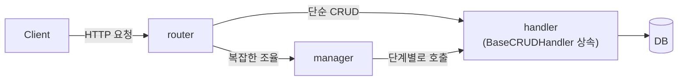

> **한 줄** — router는 요청을 받아 연결만 한다. 테이블 하나에 대한 단순 CRUD는 handler, 여러 단계·여러 handler를 조율하는 복잡한 로직은 manager. 코드 리뷰에서 자주 나오는 "handler만 있을 때 생기던 문제 → manager 도입" 배경을 정리한다.
## CRUD란
**C**reate **R**ead **U**pdate **D**elete — 데이터에 할 수 있는 4가지 기본 동작.  메모 앱으로 치면: 메모 쓰기(C)·보기(R)·고치기(U)·지우기(D).  테이블 하나를 다루는 코드는 결국 이 4가지의 반복이다.
## 3단 분리
<table fit-page-width="true" header-row="true">
<tr>
<td>레이어</td>
<td>역할</td>
<td>복잡도</td>
<td>예시</td>
</tr>
<tr>
<td>`router`</td>
<td>HTTP 요청 받아 handler/manager 호출, 응답 조립</td>
<td>낮음</td>
<td>`user_router`의 `create_user`</td>
</tr>
<tr>
<td>`handler`</td>
<td>테이블 하나의 단순 CRUD</td>
<td>낮음</td>
<td>`user_handler` — 공통 `BaseCRUDHandler` 상속</td>
</tr>
<tr>
<td>`manager`</td>
<td>여러 단계·여러 handler를 조합하는 복잡한 비즈니스 로직</td>
<td>높음</td>
<td>`resource_manager`의 외부 연결 등록</td>
</tr>
</table>

## 왜 manager가 따로 생겼나
> **원래는 handler만 있었다.** 조회 로직이 조금만 복잡해지면 사람들이 handler를 무시하고 직접 DB session을 열어서 썼다.
> 그 결과 **DB 접근 경로가 코드베이스 전체에 흩어져서 추적이 안 되는 문제**가 생겼다.
> 그래서 규칙을 정했다 — **단순 CRUD는 handler, 복잡한 로직은 manager.** 직접 session 열던 코드는 전부 manager를 거치도록 교체.
**남아 있는 문제**: manager가 도입된 이후 계속 뭔가 추가되다 보니, "복잡한 조회만 담당"해야 할 레이어에 도메인 로직이 섞여 들어가 역할 경계가 흐려졌다. 좋은 의도로 만든 레이어도 시간이 지나면 책임이 불분명해질 수 있다는 실제 사례 — no smelly code 관점에서 "레이어 책임 흐림"도 스멜의 한 종류.
## 언제 manager로 승격하나 — 판단 기준
> 로직이 **여러 단계**로 늘어나거나, **여러 handler를 조합**해야 하거나, **직접 session 여는 코드**가 생기려는 순간 → manager로 뽑을 신호.
다음과 같은 상황을 생각해 보자. 인증 메일 발송(토큰 발급 + 메일 발송, 딱 2단계)이 router 파일 안에 직접 있는 걸 보고 리뷰어가 "email manager로 빼야 하지 않냐"고 제안했지만, 저자는 "지금은 2단계뿐이라 이르다, 팀 초대 기능까지 붙어 로직이 커지면 그때 판단하자"고 답했다. **미리 만들지 않는 것도 YAGNI에 가까운 판단** — 필요성이 증명되기 전엔 레이어를 늘리지 않는다.
## 신입이 기억할 핵심
> 3단 분리의 목적은 "이름 맞추기"가 아니라 **DB 접근 경로를 한 군데로 모아 추적 가능하게 하는 것**(캡슐화). 그리고 그 경계는 고정된 게 아니라 **코드 볼륨이 늘어날 때 재판단하는 살아있는 기준**이다.
## `schema/` — 데이터 모양만 정의
요청/응답의 "어떤 필드가 오고 가는지"만 정의하는 Pydantic 클래스들. 로직은 없다. 예: `UserCreateRequest`(요청), `GetUserResponse`(응답). FastAPI가 이 모양으로 자동 검증하고 OpenAPI 문서도 만든다.
## `modules/` — 비즈니스 로직이 사는 곳
router가 얇은 이유가 여기에 있다 — "실제 일"은 도메인별 폴더(`account/`, `resource/`, `assistant/`, `graph/`, `crud/` ...) 안의 handler·manager가 담당한다. router는 "어느 URL", modules는 "무슨 일이 실제로 일어나는지"를 담당.
## manager가 실제로 하는 일 — 패턴 4가지
<table fit-page-width="true" header-row="true">
<tr>
<td>패턴</td>
<td>예시</td>
</tr>
<tr>
<td>여러 단계를 순서대로 조율</td>
<td>외부 서비스 사용자 등록 — 중복확인→유저생성→쿼터→API키→기본 설정, 여러 단계</td>
</tr>
<tr>
<td>하기 전에 검증(가드)부터</td>
<td>`validate_merge` → `merge_records`</td>
</tr>
<tr>
<td>외부 서비스 호출 조율</td>
<td>외부 소스 등록(연결테스트→스키마읽기→저장)</td>
</tr>
<tr>
<td>여러 handler 조회를 하나로 합치기</td>
<td>접근 가능한 리소스 목록 — 여러 저장소의 결과 통합</td>
</tr>
</table>
**정리**: manager는 "이 시나리오를 완성하려면 어느 순서로 무엇을 검증하고 호출해야 하는가"를 아는 층이다. handler는 "테이블 하나 CRUD"만 안다.
---
> **관련**: 아키텍처 레이어 이름은 프레임워크마다 다르다.

---
