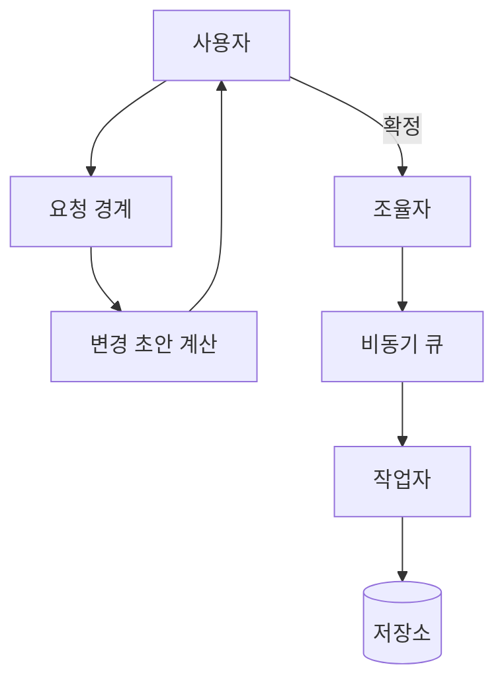

업무 기능을 추가할 때 도메인 규칙, 외부 서비스 연결, HTTP 요청 처리를 한 함수에 넣으면 변경 영향과 테스트 범위를 파악하기 어렵다. 의존성 경계를 두고 각자 맡은 역할을 작게 유지하면 테스트하기 쉽고 교체도 수월하다.

## 의존성 방향

핵심 규칙은 데이터베이스, 웹 프레임워크, 외부 API를 직접 호출하지 않는다. 필요한 동작을 함수 인자로 받거나 작은 인터페이스로 표현하고, 바깥쪽 어댑터가 실제 구현을 연결한다.

```python
def suggest_merge(left, right, ask_model):
    prompt = f"Compare {left['name']} and {right['name']}"
    return ask_model(prompt)
```

`ask_model`에 실제 API 호출을 전달할 수도 있고, 테스트에서는 결과를 고정한 가짜 함수를 전달할 수도 있다. 핵심 로직은 네트워크 없이 검증된다.

## 레이어의 책임

| 레이어 | 책임 |
| --- | --- |
| 도메인 | 입력 검증과 업무 규칙, 외부 시스템을 모르는 계산 |
| 어댑터 | DB·LLM·파일 저장소 같은 외부 의존 구현 |
| 애플리케이션 조율자 | 단계와 트랜잭션, 재시도·중복 방지 규칙 조율 |
| HTTP 경계 | 요청과 응답 변환, 인증·권한 확인 |
| 작업자 | 큐에서 받은 오래 걸리는 작업 수행 |

요청 흐름은 보통 `HTTP 경계 → 조율자 → 도메인/어댑터` 순서다. 실제 배치와 이름은 프로젝트마다 다르며, 이 표는 특정 회사의 소스 구조가 아닌 일반 예시다.

## 초안과 반영을 분리하기

변경 전에 미리보기나 초안을 보여주고 사용자가 확정한 다음 쓰기 작업을 수행하면, 검토와 파괴적 변경을 나눌 수 있다.



초안 계산은 저장소를 변경하지 않는 순수 계산으로 유지한다. 미리보기와 실제 반영이 같은 계획 함수를 사용하면 두 경로의 결과가 달라질 위험도 줄어든다.

## 공통 엔진과 작업별 동작

여러 작업이 큐잉, 중복 방지, 상태 기록을 공유한다면 공통 부분은 한 곳에 두고 작업별 차이만 전달한다. 다만 실제로 반복이 확인되기 전에 공통 엔진부터 만들 필요는 없다.

## 변경을 나누는 기준

PR은 파일 수가 아니라 의존성 경계와 독립 리뷰 가능성으로 나눈다. 기반 계약과 순수 계산을 먼저 준비하고, 어댑터와 비동기 처리, 마지막으로 HTTP 연결을 붙이는 순서가 이해하기 쉽다. 반환 계약과 유일한 소비자가 강하게 맞물리면 한 변경으로 유지한다.

## 확인 질문

- 핵심 규칙이 네트워크나 프레임워크에 직접 의존하는가?
- 미리보기와 실제 반영이 같은 계산을 공유하는가?
- 여러 단계의 쓰기가 실패할 때 원자성이나 보상 동작이 정의되어 있는가?
- 큐 재시도에도 중복 작업을 막을 수 있는가?
- 현재 필요한 경계만 만들었는가?
